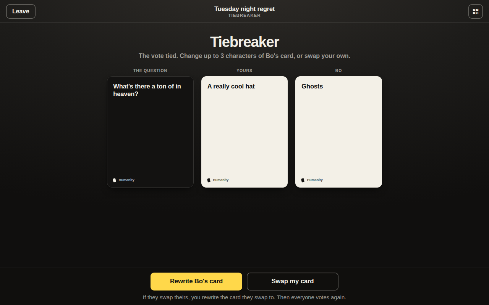
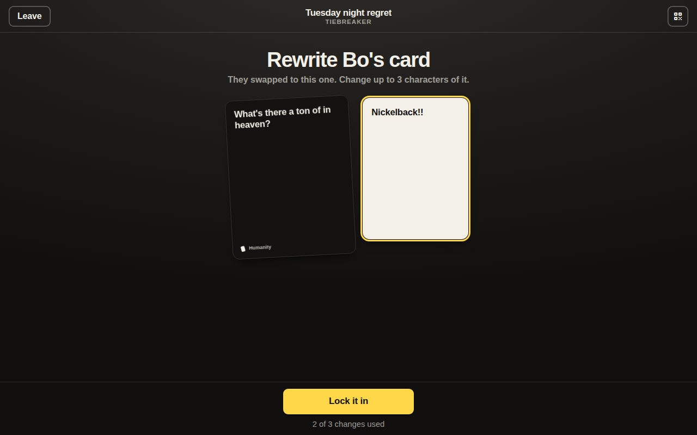

# Humanity

My digital take on the; wonderful, terrible, hilarious, hideous game provided by [these fine folks](https://cardsagainsthumanity.com/), and inspired by [jackbox](https://www.jackboxgames.com/).

One machine runs the game. Everyone plays from their own phone, and a shared screen can show the table. No accounts, no app to install: a link or a QR code gets someone a seat.


## Quick start

You need [Bun](https://bun.sh/).

```sh
bun install
bun start
```

Open [http://localhost:8032](http://localhost:8032), start a game, and have everyone else scan the room's QR code. Phones need to be on the same network as the machine running it.

## How it plays

There is no judge. Everyone answers, everyone votes.

1. **Start a room.** Name it (or roll the dice for a name), set the hand size, and pick the card packs to build the deck from.
2. **Sit down.** Players join from the hub, the room's link, or its QR code, and ready up. A round starts once everyone at the table is ready; it takes at least two.
3. **Play a card.** Everyone picks the white card from their hand that best answers the black card. Cards go in face down.
4. **Vote.** The cards are turned over, without names. Everyone votes for their favorite; nobody can vote for their own.
5. **Round over.** The card with the most votes wins the round. Now the names come out: who played what, the votes each card took, and the standings. Anyone can deal the next round.

Someone who sits down mid-round is dealt in for the next one, or can jump in while cards are still being played. Someone who leaves puts their hand back in the deck, and the round goes on without them. A seat is kept by the browser it was taken from, so a closed tab or a dead phone can come back to it.

### Ties

A vote tied for the most goes to a tiebreak between the tied players. Each makes one move, unseen by the other until both are made:

- **Rewrite** the opponent's card, changing up to three characters of it, or
- **Swap** their own card for another from their hand.

Swaps land first, so a rewrite is of the card its player ends up with. Then everyone votes again on the tied cards alone. Still tied, they share the round. With two players each can only vote for the other, so they share it without a tiebreak.





### The shared screen

Any room can be watched instead of joined: put it on a TV. It shows the black card, cards arriving face down and turned over for the vote, the round's result, who the table is waiting on, and the QR code to join.


## Screenshots


## Running it

| Command     | What it does                                                           |
| ----------- | ---------------------------------------------------------------------- |
| `bun start` | Runs the game on port 8032                                             |
| `bun dev`   | The same, restarting the server on save and rebuilding the client page |

Options, after the command (`bun start --port 9000`):

| Option        | Short | Default            | What it sets                          |
| ------------- | ----- | ------------------ | ------------------------------------- |
| `--port`      | `-p`  | `8032`             | The port to serve on                  |
| `--database`  | `-d`  | `~/.humanity.json` | Where rooms are kept between restarts |
| `--verbosity` | `-v`  | `1` (`3` in dev)   | How much is logged: 0 is all, 3 debug |

Rooms, hands and scores are saved to the database file, so a restart picks up where the table left off.

To keep it running in the background (a systemd user unit on Linux, a launchd agent on macOS):

```sh
bun run service:enable    # install and start it, on port 8032
bun run deploy            # rebuild the page and reload the service
bun run service:disable   # stop and remove it
```

## Card packs

Each file in `cards/` is a pack, named for its file. A room's deck is every card of the packs picked for it, shuffled, with repeats across packs dealt once. Between them a room's packs need both black and white cards.

The decision to use only single entry cards was purposeful. I have found that things simply run smoother with single entry cards, even in the physical game.

### Make your own

Put a JSON file in the `cards` folder and restart the server:

```json
{
	"blacks": ["card text _____"],
	"whites": ["card text"]
}
```

A pack can hold only blacks or only whites, to be played alongside another. A card's text is HTML, so a line break (`<br>`), an accent (`&eacute;`) or a [Font Awesome](https://fontawesome.com/) icon (`<i class="fas fa-flag"></i>`) all work.

## Development

```sh
bun dev          # run with reloading
bun test         # the game's rules, the card rewrite rule, the routes and components
bun run lint     # eslint
bun run format   # eslint --fix, then prettier
```

Where things are:

```
cards/     the packs
client/    the page: one file per screen (Hub, Create, Join, Play, Watch), the shared pieces, and theme.js for the look
rules/     rules both the page and the server ask (what a tiebreak rewrite may change)
server/    game.js is the whole game: its stages, what each player may do, and what each page is shown
```

The server and the rooms, seats and sockets under the game come from [web-game-framework](https://github.com/fatlard1993/web-game-framework); the page is built from [vanilla-bean-components](https://github.com/fatlard1993/vanilla-bean-components).

What's planned is in [TODO.md](./TODO.md).
